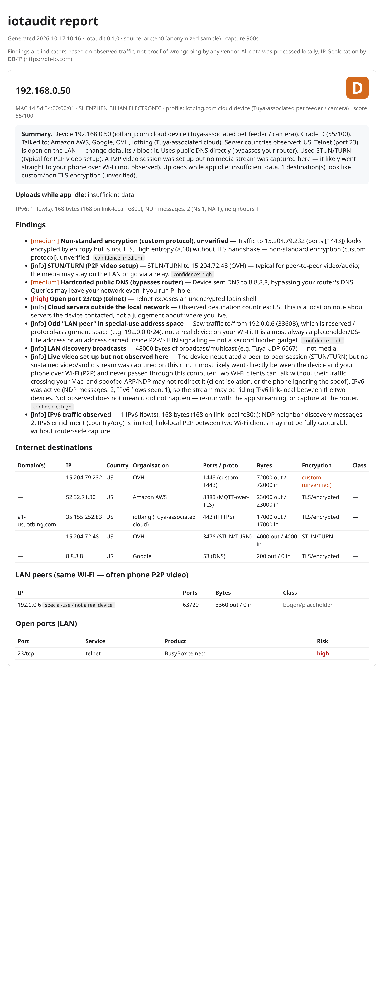

# iotaudit

<!-- mcp-name: io.github.emirmrkaljevic/iotaudit -->

[](https://github.com/emirmrkaljevic/iotaudit/actions/workflows/ci.yml)
[](LICENSE)
[](https://www.python.org/)
[](https://pypi.org/project/iotaudit/)

<p align="center"><a href="https://skintoscan.com/#packages"></a><br><sub>If you find this useful, you can support me by getting a SkinToScan pack, my other project. It's a one-time purchase that directly funds my open-source work.</sub></p>
<p align="center"><a href="https://skintoscan.com/checkout/?add-to-cart=138"></a> <a href="https://skintoscan.com/checkout/?add-to-cart=139"></a> <a href="https://skintoscan.com/checkout/?add-to-cart=140"></a></p>

**Is your smart pet feeder, camera or plug safe?** `iotaudit` watches what your own IoT devices
do on the network and gives each one an **A-F grade**, a one-line safety verdict, and a one-page HTML report. Everything
runs locally: no account, no telemetry, no cloud.

It answers the questions you actually have about a cheap smart device:

- **What is the short version?** A one-line verdict next to the grade. Open ports, public DNS,
  TLS or plaintext, and destination countries are observed facts. Video, audio, and other
  traffic patterns stay indicators with a confidence.
- **Who does it talk to?** Domains (DNS + TLS SNI + HTTP Host), IPs, country, organisation.
  The report lists the destination countries for each device (observed fact).
- **What does the traffic look like?** A separate per-device indicator for video, audio,
  telemetry, or unknown, each with a low, medium, or high confidence. It is a pattern
  match, not proof of what was sent.
- **Is it encrypted?** Plaintext HTTP, unencrypted TCP, old TLS, or "custom" high-entropy protocols.
- **What ports are open?** Optional `nmap` scan with risk notes (telnet, RTSP, UPnP, ADB, …).
- **Any known issue for this banner?** A short offline hint when a version
  string matches a curated CVE. It does not change the grade unless the
  version match is exact and the entry is critical.
- **Is it reachable from the internet?** Lists the port forwards your router opened via UPnP
  and which device they point to (read-only, never changes the router).
- **Does it phone home while idle?** Idle-upload check and a traffic timeline with bursts.
- **Where did the video go?** LAN peer (phone P2P) vs cloud vs STUN/TURN, and an honest note
  when a stream was set up but never actually passed through your computer.
- **What changed since the last audit?** `iotaudit diff` compares two saved JSON
  results and exits 1 when a new destination, country, open port, worse grade,
  unencrypted flow, UPnP forward, or device appeared.

> Status: **0.1.10**. Hotspot + ARP capture, pcap and PCAPdroid analysis, IPv6/NDP, device-type
> identification, UPnP port-forward audit, an opt-in default-password check, grading with a
> one-line safety verdict, HTML and PDF reports, a diff between two audits, offline known-issue
> hints, a local web UI and the MCP server work. A full vulnerability feed is still on the
> [roadmap](ROADMAP.md).

## Sample report

A report for a Tuya-associated pet feeder (anonymized). The one-line verdict sits beside the
grade: telnet open on the LAN, public DNS, TLS cloud traffic to the US, unverified custom
encryption, and a P2P video setup whose stream was not observed on this run. The longer summary
is still underneath. It also shows an odd **special-use "LAN peer"** that is not a real device:



Open [`docs/sample-report.html`](docs/sample-report.html) in a browser for the full version.

## Demo

A short walk-through of a capture, the UPnP port-forward check and the opt-in default-password
check (animated SVG, no audio, no tracking):


## Install

```bash
pipx install iotaudit
# or with the MCP server extra, and PDF export:
pip install "iotaudit[mcp]"
pip install "iotaudit[pdf]"
# latest from source:
pipx install "git+https://github.com/emirmrkaljevic/iotaudit"
```

Capturing needs root (`sudo`). The optional port scan needs `nmap`.

## Quickstart

### macOS

```bash
brew install nmap
pipx install iotaudit

# Just run it: pick your device from the list, then leave it alone (or use its app).
sudo "$(which iotaudit)" capture --mode arp --i-own-this-network
```

iotaudit scans your LAN, lists devices (IP, MAC, vendor; Tuya/Espressif flagged as likely IoT),
and lets you pick one. It then ARP-spoofs **only that device** so its traffic flows through your
Mac, captures for up to an hour (Ctrl+C stops early and still writes the report), and restores the
ARP tables and IP-forwarding on exit. With a device picked, `--watch-lan` (phone P2P) and the
IPv6/NDP filter are on by default.

### Linux

```bash
sudo apt install nmap
pipx install iotaudit

# Same ARP flow as macOS:
sudo "$(which iotaudit)" capture --mode arp --i-own-this-network

# Or hotspot mode: your laptop becomes an AP; re-pair the device to it (needs NetworkManager).
sudo iotaudit capture --mode hotspot --iface wlan0 --ssid iotaudit --password 'choose-a-pass' \
     --device 10.42.0.50 --scan --out feeder.html
```

### Analyse an existing capture

```bash
# from Wireshark, your router, or OpenWrt `tcpdump -w`
iotaudit analyze capture.pcap --device 192.168.1.50 --json results.json --out report.html
```

The report lands at `./iotaudit-report.html` with a matching `.json` next to it.

## Known-issue hints

iotaudit compares banners it already has with a small catalog shipped in the
package (`src/iotaudit/data/known_issues.yaml`). The facts it can use are:

- an open service from the port scan, plus the nmap product and version
- an HTTP `Server` header from a response the device sent
- a UPnP or SSDP header (including an InternetGatewayDevice advertisement)
- an RTSP response that did not ask for authentication, when that was already
  in the capture or in the scan record

There is no lookup at runtime and no `hints --update-from` command. The file
changes only when you install a newer iotaudit.

Each hint is a possibility, not proof the firmware is vulnerable. The text
always includes: possible, based on version string; verify firmware. The
reference is the NVD page for that CVE.

Hints show in the HTML report, in the PDF (the PDF is the same HTML), in the
device JSON as `known_issue_hints`, and in the MCP `analyze_pcap` result.

**Grade rule.** A hint does not change the A-F grade unless both are true:
the observed version string equals a version the entry lists exactly, and the
entry severity is critical. That case subtracts 25 points, the same as one
high finding, and the subtraction is applied after the limited-data cap so it
still moves a thin capture. A version range, a product name without that
exact version, an open port on its own, or any severity other than critical
leaves the score unchanged. Telnet being open, an exposed UPnP IGD, or RTSP
with no authentication is not by itself a CVE. The catalog cites one only
when the banner or the service fact matches that entry.

Limits:

- The file is a short curated list (on the order of 10 to 20 issues), not the
  NVD and not a firmware database.
- A patched device can still show an old version string. An unpatched device
  can hide the version. Either way the hint says to verify the firmware.
- Banners are read from IPv4 packets and from the nmap record. IPv6 service
  banners are not parsed.
- RTSP with no authentication is recorded when a captured RTSP `200` has no
  `WWW-Authenticate` header, or when the scan extra info already says so. The
  shipped list does not treat that fact alone as a CVE. It is mentioned on a
  hint when a versioned RTSP entry also matches.
- No network access is used to refresh the list.

## PDF export

```bash
pip install "iotaudit[pdf]"

# Writes report.pdf next to report.html:
iotaudit analyze capture.pcap --device 192.168.1.50 --out report.html --pdf
sudo "$(which iotaudit)" capture --mode arp --i-own-this-network --pdf

# Convert a report you already saved (HTML, or the JSON list of devices):
iotaudit report --pdf report.html
iotaudit report --pdf results.json --out results.pdf
```

`--pdf` on `analyze` and `capture` writes a PDF next to the HTML. Print styles put the grade
and verdict at the top of each device (the first device shares page 1 with the title; every
later device starts on a new page), keep table rows in one piece, and repeat the table header.
The on-screen traffic chart is left out of the PDF.

The renderer is xhtml2pdf, a pure-Python extra (`xhtml2pdf`, pulled in by `iotaudit[pdf]`).
No Cairo or Pango install is required. If the extra is not installed, `analyze` and `capture`
still write the HTML and print one install line. `iotaudit report --pdf` prints that same line
and exits, because the PDF is its only output. The MCP tool `analyze_pcap` takes `pdf=true`
together with `report_path` and writes the PDF beside the HTML.

## Compare two audits

```bash
iotaudit diff "$HOME/iotaudit/yesterday.json" "$HOME/iotaudit/today.json"
iotaudit diff "$HOME/iotaudit/yesterday.json" "$HOME/iotaudit/today.json" --json

# Same diff, printed after the HTML and JSON report:
iotaudit analyze capture.pcap --device 192.168.1.50 \
    --json "$HOME/iotaudit/today.json" --out "$HOME/iotaudit/today.html" \
    --compare "$HOME/iotaudit/yesterday.json"
```

Devices match by MAC. If either side has no MAC, they match by IP. A different MAC at
the same IP is one device gone and one device new. For each device the report lists new
and gone destination domains and IPs, new countries, new open ports, grade changes,
verdict changes, newly seen unencrypted traffic, and new UPnP forwards when the JSON
has them.

Exit code **1** when something security-relevant appeared: a device, a destination
domain or IP, a country, an open port, a worse grade, unencrypted traffic, or a UPnP
forward. Exit code **0** otherwise, including when the only changes are departures or
a better grade. A verdict change is printed either way and does not by itself exit 1.
Missing or unreadable input exits 2. With `--compare`, `capture` and `analyze` use
that same code after they write the report.

`capture` and `analyze` already write JSON (next to the HTML, or at `--json`). Keep
the previous file and pass it as `--compare`, or run `diff` on the two files later.
`--json` on `diff` prints the machine-readable result. On `capture` and `analyze`,
`--json` is still the path of the results file.

Cron stays quiet when nothing new showed up. This script prints the diff, and exits
1, only when something security-relevant appeared:

```sh
#!/bin/sh
# 15 6 * * 1-5 "$HOME/iotaudit/check.sh"
report=$(iotaudit diff "$HOME/iotaudit/yesterday.json" "$HOME/iotaudit/today.json") || {
    printf '%s\n' "$report"
    exit 1
}
exit 0
```

LAN peers are not compared. Open ports are the scanned `open_ports`, not the remote
port a destination was contacted on. UPnP is read from findings with category `upnp`,
or from a top-level `upnp.mappings` list joined on `internal_client`. An audit saved
without a UPnP check has no forwards, so the next audit's forwards show up as new.
Other findings are not listed one by one; a grade or verdict change still shows when
those findings moved the grade or the verdict.

## IPv6, P2P video, and "not observed"

Live video from a camera or feeder often does **not** go to the cloud: it goes **directly to your
phone** over the local Wi-Fi (P2P), after a short STUN/TURN handshake. iotaudit tries hard to see
that stream (`--watch-lan` spoofs device↔phone, and the capture filter now includes IPv6 and NDP),
but two Wi-Fi clients can talk **without their traffic ever passing through your computer**.
because of Access-Point client isolation, a phone ignoring the spoof, or the stream riding IPv6
link-local (`fe80::`). When that happens the report says so honestly:

> *Live video set up but not observed here*: the session was negotiated (STUN) but no sustained
> stream was captured; it most likely went straight to your phone. **Not observed ≠ not happening.**

For ground truth, capture at the router instead. `--ipv6-ndp` (experimental) also NDP-spoofs IPv6
link-local pairs.

## Default-password check (opt-in)

```bash
iotaudit credcheck 192.168.0.50                 # telnet by default
iotaudit credcheck 192.168.0.50 --service telnet --service http
```

The one active login iotaudit makes, and only when you ask for it. It tries a short list of
documented **vendor default** credentials (e.g. the `root`/`xc3511` that the Mirai-era cameras
shipped with), never a password wordlist. You confirm the exact IP by typing a phrase, it only
targets a LAN address, it waits between attempts, stops at the first login that works, and reports
just **"default login accepted"** or **"not accepted"**; it never keeps or uses the session. Use
it on your own devices only.

## Router port forwards (UPnP)

```bash
iotaudit upnp          # or --json
```

Many devices quietly ask the router to open a public port to themselves. `iotaudit upnp` lists
every UPnP port forward and the LAN device it points to. It only sends the two read-only UPnP
queries, and only to a router on a private address. It also runs after each `capture` (skip with
`--no-upnp`) and adds a finding when a forward points at the audited device. If nothing answers,
UPnP is off on your router, which is the safest setting.

## Web UI and phones

```bash
iotaudit web                          # http://127.0.0.1:8765, token printed on start
sudo "$(which iotaudit)" web --lan    # also from a phone on the same Wi-Fi (token required)
```

View reports, upload a pcap (including **PCAPdroid** captures from Android) and run a one-click
scan & capture from the browser. Localhost by default; `--lan` is opt-in, token-protected and only
answers private-range clients. iPhones can use the web UI but cannot capture on their own; see
[docs/phones.md](docs/phones.md) for what works on Android and iOS and what does not.

## MCP server

```bash
iotaudit-mcp        # exposes audit tools to a local assistant ("audit my pet feeder")
```

`diff_results` compares two saved JSON audits the same way `iotaudit diff` does.

## Consent & scope

iotaudit only audits **your own** network. It refuses non-private targets and requires
`--i-own-this-network` (or an interactive `I OWN THIS NETWORK` confirmation). ARP/NDP spoofing on a
network you do not own may be illegal.

Findings are **indicators based on observed traffic, not proof** of wrongdoing by any vendor.
IP geolocation by [DB-IP](https://db-ip.com). MIT licensed.
