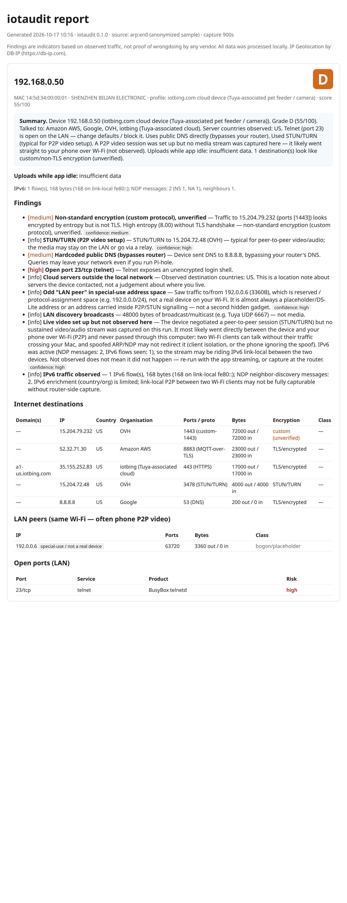

# Reports, PDF, and sharing

Each audit writes a one-page HTML report with an A-F grade and a one-line safety verdict per device. A matching JSON file is saved next to it. A PDF is written when the `iotaudit[pdf]` extra is installed, or when you pass `--pdf`.

## Sample report

A report for a Tuya-associated pet feeder (anonymized). The one-line verdict sits beside the grade: telnet open on the LAN, public DNS, TLS cloud traffic to the US, unverified custom encryption, and a P2P video setup whose stream was not observed on this run. The longer summary is still underneath. It also shows an odd special-use "LAN peer" that is not a real device:

Open [sample-report.html](sample-report.html) in a browser for the full version.

## Demo

A short walk-through of a capture, the UPnP port-forward check and the opt-in default-password check (animated SVG, no audio, no tracking):

The compact `auto` demo used in the README is [auto-demo.svg](auto-demo.svg).

## PDF export

The command line, print styles, and the xhtml2pdf extra are documented in the [usage guide](usage.md#pdf-export). `--pdf` on `analyze` and `capture` writes a PDF next to the HTML. `iotaudit report --pdf` converts a report you already saved. The MCP tool `analyze_pcap` takes `pdf=true` together with `report_path`.

## Export and redaction

`iotaudit export` writes the per-device summary as JSON, CSV, or Markdown. Add `--compare` to fill in what changed, and `--redact` to leave IP addresses out of the summary (devices named only by their IP become "device 1", "device 2", and so on).

To share a full report in one step, `iotaudit report audit.json --redact` writes `audit.redacted.html` with local IPs, MACs and hostnames replaced by labels like `lan-1`. Add `--pdf` for a PDF (needs `pip install "iotaudit[pdf]"`). Or keep the JSON copy with `iotaudit redact audit.json`.

Since 0.1.21, `--redact` also drops nested capture metadata (`source`, `iface`, `interface`, `ssid`, `path`, `pcap`) on nested `meta` objects as well as the top-level one, and drops `iface`, `interface`, `ssid` and `pcap` keys wherever they appear. Hint sources and HTTP paths are kept.

Give a redacted file a quick read before you post it. Redaction is not a guarantee of complete anonymity. The full walk-through is in [share results](share-results.md).
